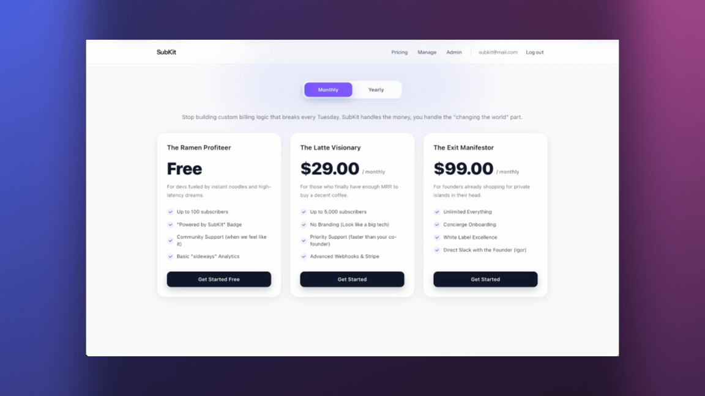

# SubKit

Laravel subscriptions with a ready-to-use Filament UI.  
Replace days of custom billing logic with a working setup on top of Stripe (Cashier).

- Skip custom subscription logic
- Skip building pricing UI
- Skip wiring Stripe webhooks manually

[](art/screen-subkit-theme-default.png)


SubKit provides a Filament admin panel to manage plans and plan sets, themeable Blade components for your pricing page and subscription dashboard, and a clean PHP API for subscription lifecycle operations.

**Why use SubKit?**
While Laravel Cashier is incredibly powerful, building the actual UI and admin panel for subscriptions takes days. SubKit bridges this gap by providing a **"Lickable UI"** out of the box and a powerful Filament admin to manage it all without writing boilerplate code.

## What it does

- Integrates with Stripe via Laravel Cashier (webhooks, checkout sessions, billing portal)
- Provides a Filament admin panel to manage Plans, Plan Sets, Provider Prices, Features, and Limits
- Provides Blade components: a pricing table and a subscription management UI, with multiple themes
- Exposes a PHP facade and REST API for subscription operations (checkout, cancel, resume, billing portal)
- Exposes runtime plan limits (e.g. `max_locations`, `max_users`) via a `HasCapabilities` trait with built-in caching

## Live Demo

Try it in action: **[subkit.noxls.net](https://subkit.noxls.net)**

* Register a test account to explore the customer billing flow.
* Once registered, navigate to **`/admin`** to check out the Filament control panel.

## What it does NOT do

- Process payments or store card data
- Replace Stripe or Laravel Cashier — it orchestrates on top of them
- Handle invoicing, taxes, or compliance
- Manage user authentication or access control (your app's policies decide who may use the admin, see [Access control](https://subkit.noxls.net/docs/access-control))

---

## Requirements

- PHP 8.4+, Laravel 12+
- Laravel Cashier (`laravel/cashier` ^16.5) and Filament (`filament/filament` ^5.0)
- MySQL 8+ (or MariaDB 10.5+)
- A Stripe account

## Quick start

```bash
composer require karpovigorok/subkit
php artisan vendor:publish --tag=subkit-config
php artisan vendor:publish --tag=subkit-migrations
php artisan migrate
```

Register the plugin in your Filament panel provider, make your `User` use Cashier's `Billable` trait, and set `STRIPE_KEY`, `STRIPE_SECRET` and `STRIPE_WEBHOOK_SECRET`:

```php
->plugin(\SubKit\Filament\SubKitPlugin::make());
```

Create a plan in the admin panel (`/admin`), then drop the pricing table into any Blade view:

```blade
<x-subkit::pricing-table
    success-url="{{ route('dashboard') }}"
    cancel-url="{{ route('pricing') }}"
/>
```

## Documentation

Full docs: **[subkit.noxls.net/docs](https://subkit.noxls.net/docs)** (Markdown sources also live in [`docs/`](docs/) on GitHub).

| | |
|---|---|
| [Installation and configuration](https://subkit.noxls.net/docs/installation) | [Stripe setup](https://subkit.noxls.net/docs/stripe) |
| [Usage](https://subkit.noxls.net/docs/usage) | [Plans, features and limits](https://subkit.noxls.net/docs/plans) |
| [Private plans](https://subkit.noxls.net/docs/private-plans) | [B2B / team billing](https://subkit.noxls.net/docs/b2b) |
| [Checkout hook](https://subkit.noxls.net/docs/checkout-hook) | [Top-ups](https://subkit.noxls.net/docs/top-ups) |
| [Access control](https://subkit.noxls.net/docs/access-control) | [Themes](https://subkit.noxls.net/docs/themes) |
| [REST API](https://subkit.noxls.net/docs/api) | [Events](https://subkit.noxls.net/docs/events) |
| [Upgrading](UPGRADING.md) | [Changelog](CHANGELOG.md) |

## Testing

```bash
composer test
```

## License

MIT
